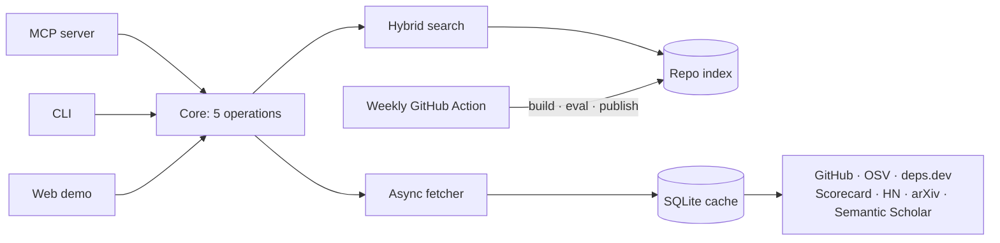

<p align="center"></p>

<h1 align="center">Ideation GOAT</h1>

<p align="center"><b>What should I build this with, and is it safe to depend on?</b></p>

<p align="center">
<a href="https://github.com/AdityaTummuri/ideation-goat/actions/workflows/test.yml"></a>


</p>

<!-- mcp-name: io.github.AdityaTummuri/ideation-goat -->

Describe what you want to build and get a ranked shortlist of open-source libraries, each with live
health, security and license signals. Every number links to where it came from. Anything that couldn't be
fetched says **unknown** instead of guessing.

It works as an **MCP server** for AI coding agents, a **CLI**, and a **web demo**, all on one core.
That matters because agents often suggest packages from stale training data: outdated, abandoned, or
not real at all. Ideation GOAT checks before you install.

## Example

```text
$ ideation-goat compare fastapi/fastapi pallets/flask litestar-org/litestar

|                   | fastapi/fastapi  | pallets/flask | litestar-org/litestar |
|-------------------|------------------|---------------|-----------------------|
| Health            | 100/100 (75%*)   | 84/100        | 97/100 (75%*)         |
| Stars             | 105,047          | 75,356        | 8,567                 |
| Last push         | 2026-11-18       | 2026-10-30    | 2026-11-22            |
| Latest release    | 2026-11-18       | 2026-02-19    | 2026-10-18            |
| Contributors      | 457              | 398           | 300                   |
| License           | MIT              | BSD-3-Clause  | MIT                   |
| OpenSSF Scorecard | unknown          | 7.1           | unknown               |
| HN stories        | 32               | 7             | 5                     |
| Cloud lock-in     | none found       | none found    | none found            |

* score based on 75% of inputs: Scorecard hasn't scanned this repo
```

```text
$ ideation-goat verify requests --version 2.31.0

latest version: 2.34.2 · license: Apache-2.0 · deprecated: no
known vulnerabilities in 2.31.0: 3
- GHSA-9hjg-9r4m-mvj7 [MODERATE] .netrc credentials leak via malicious URLs, fixed in 2.32.4
- GHSA-9wx4-h78v-vm56 [MODERATE] Session doesn't verify after a verify=False request, fixed in 2.32.0
- GHSA-gc5v-m9x4-r6x2 [MODERATE] Insecure temp file reuse in extract_zipped_paths(), fixed in 2.33.0
```

## Tools

| Tool | You give it | You get back |
| --- | --- | --- |
| `find_libraries` | An idea in plain words, optional language | Top matching repos with a reason, health score, license and latest release |
| `compare_libraries` | 2–5 GitHub repos | A side-by-side scorecard: activity, releases, contributors, Scorecard, HN, cloud lock-in |
| `verify_package` | A package name, ecosystem, optional version | Whether it exists, latest version, deprecation, license, known vulnerabilities |
| `check_dependencies` | A project folder | Vulnerable pinned versions and license conflicts across manifests and lockfiles |
| `find_papers` | A research topic | Papers from arXiv and Semantic Scholar with citations and open PDFs |

Ecosystems: PyPI, npm, crates.io and Go. All tools are read-only and return typed, structured output.

## Get started

Requires [uv](https://docs.astral.sh/uv/). Every API key is optional; a `GITHUB_TOKEN` raises GitHub's limit
from 60 to 5,000 requests an hour.

**CLI**

```bash
uvx --from git+https://github.com/AdityaTummuri/ideation-goat ideation-goat find "rate limiter for a Python API"
```

Commands: `find`, `compare`, `verify`, `check`, `papers`. Add `--json` for machine-readable output.

**MCP: Claude Code**

```bash
claude mcp add ideation-goat -- uvx --from git+https://github.com/AdityaTummuri/ideation-goat ideation-goat
```

**MCP: Claude Desktop, Cursor, VS Code and others**

```json
{
  "mcpServers": {
    "ideation-goat": {
      "command": "uvx",
      "args": ["--from", "git+https://github.com/AdityaTummuri/ideation-goat", "ideation-goat"],
      "env": { "GITHUB_TOKEN": "<optional>" }
    }
  }
}
```

The server runs over stdio by default; `ideation-goat serve --http` serves Streamable HTTP.
`check_dependencies` only reads folders inside the server's working directory.

**Web demo**

```bash
git clone https://github.com/AdityaTummuri/ideation-goat && cd ideation-goat
uv sync --extra ui && uv run streamlit run streamlit_app.py
```

## How it works



- **One core, thin adapters.** The MCP server, CLI and demo all call the same typed functions, so one test suite covers all three.
- **Hybrid search.** BM25 over READMEs, descriptions and topics, plus local MiniLM embeddings (no API key), merged with reciprocal rank fusion.
- **No database server.** The index is a few thousand repos in numpy arrays, rebuilt weekly by GitHub Actions and published as a release asset that downloads on first use.
- **Built for free quotas.** Concurrent requests with retries, per-host rate limits (arXiv: one request per 3 s) and a SQLite cache: 24 h for repo data, 6 h for vulnerabilities.
- **Version-aware security.** OSV is always queried with the exact version, and one issue listed under several ids (GHSA, PYSEC, CVE) is shown once.

### Health score

| Part | Points | Based on |
| --- | --- | --- |
| Maintenance | 30 | days since last push |
| Releases | 15 | days since latest release |
| Community | 15 | contributor count |
| Adoption | 15 | stars, log scale |
| Security | 25 | OpenSSF Scorecard |

Unknown inputs are dropped and the score is rescaled, with the share of known inputs shown next to it.
Under half known means no score; archived repos are capped at 20. Formula: [`scoring.py`](ideation_goat/scoring.py).
It's a signal to help you decide, not a security audit.

## Evaluation

<!-- eval:start -->
_Pending the first index build._
<!-- eval:end -->

Retrieval is measured on [70 labeled queries](evals/queries.yaml), each with the repos a good engineer
would accept. Three setups are compared: embeddings only, BM25 only, and hybrid. CI fails if hybrid
Recall@5 drops more than 2 points below the baseline.

## Configuration

| Variable | Purpose |
| --- | --- |
| `GITHUB_TOKEN` | Higher GitHub rate limits; required to build the index |
| `GEMINI_API_KEY` / `GROQ_API_KEY` | Optional LLM summaries (template summary otherwise) |
| `SEMANTIC_SCHOLAR_API_KEY` | Optional; dedicated Semantic Scholar rate limit |
| `IDEATION_GOAT_HOME` | Index, cache and model location (default `~/.cache/ideation-goat`) |
| `IDEATION_GOAT_WORKSPACE` | Root folder `check_dependencies` may read (default: working directory) |

See [`.env.example`](.env.example) for the full list.

## Limitations

- The index covers popular repos in Python, JavaScript, TypeScript, Go, Rust and Java. Without it, `find_libraries` falls back to GitHub search.
- `check_dependencies` checks exact versions only; ranges without a lockfile are listed as not checked. `yarn.lock` and `pnpm-lock.yaml` aren't supported yet.
- License results flag combinations worth a closer look. They aren't legal advice.

## Development

```bash
uv sync --extra dev --extra ui
uv run pytest --cov            # recorded responses, no network
uv run ruff check . && uv run mypy ideation_goat
GITHUB_TOKEN=$(gh auth token) uv run ideation-goat index build
uv run ideation-goat eval
```

## Credits

Started as a team hackathon project by Sujay Seeram, Lochan B, Aditya Tummuri and Krishna; rebuilt around
verifiable data by Aditya Tummuri.

Data from [GitHub](https://docs.github.com/en/rest), [OSV.dev](https://osv.dev), [deps.dev](https://deps.dev),
[OpenSSF Scorecard](https://scorecard.dev), [HN Search](https://hn.algolia.com/api), [arXiv](https://arxiv.org)
and [Semantic Scholar](https://www.semanticscholar.org). Thank you to arXiv for use of its open access interoperability.

## License

[GPL-3.0](LICENSE)
