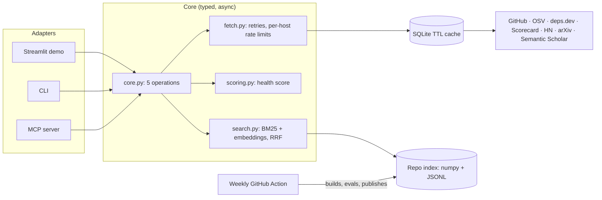

<p align="center"></p>

<h1 align="center">Ideation GOAT</h1>

<p align="center">
Describe what you want to build. Get a ranked shortlist of open-source libraries,<br>
with real, sourced health, security and license signals.
</p>

<p align="center">
<a href="https://github.com/AdityaTummuri/ideation-goat/actions/workflows/test.yml"></a>


</p>

<!-- mcp-name: io.github.AdityaTummuri/ideation-goat -->

Picking a library usually means a dozen tabs: stars, last commit, open issues, CVEs, license. AI coding
agents make it worse, because they suggest packages from old training data that may be outdated,
abandoned or nonexistent. Ideation GOAT checks those facts live and cites every one.

It ships three ways from one core: an **MCP server** for AI coding agents, a **CLI**, and a **web demo**.

## Rules every result follows

- Every number carries the URL it came from and when it was fetched.
- Nothing is invented. A signal we couldn't fetch shows as **unknown**, never as zero or a guess.
- The optional LLM summary may only use facts in the result. Without an API key, a template summary is used.
- No tool writes files. Local paths are checked against an allowed root.

## The five tools

| Tool | Input → output | Data sources |
| --- | --- | --- |
| `find_libraries` | An idea in plain words, optional language → top repos with a reason, health score, license and last release | Prebuilt README index, GitHub |
| `compare_libraries` | 2–5 repos → side-by-side scorecard, every value linked to its source | GitHub, OpenSSF Scorecard, HN Algolia, repo manifests |
| `verify_package` | Name and ecosystem, optional version → does it exist, latest version, deprecated or not, license, known vulnerabilities | deps.dev, OSV |
| `check_dependencies` | A project folder → vulnerable pinned versions and license conflicts in its manifests and lockfiles (read-only) | OSV querybatch, deps.dev |
| `find_papers` | A topic → papers with links, citation counts and open-access PDFs | arXiv, Semantic Scholar |

Supported ecosystems: PyPI, npm, crates.io and Go. `check_dependencies` reads `requirements*.txt`,
`pyproject.toml`, `uv.lock`, `poetry.lock`, `Pipfile.lock`, `package.json`, `package-lock.json`,
`Cargo.toml`, `Cargo.lock` and `go.mod`.

## Quickstart

```bash
# Run without installing (needs uv: https://docs.astral.sh/uv/)
uvx ideation-goat find "rate limiter for a Python API"
uvx ideation-goat compare fastapi/fastapi pallets/flask
uvx ideation-goat verify requests --version 2.31.0
uvx ideation-goat check path/to/project
uvx ideation-goat papers "bloom filters"
```

Add `--json` to any command for machine-readable output. The search index (about 20 MB) downloads on
first use. Setting `GITHUB_TOKEN` raises GitHub's limit from 60 to 5,000 requests an hour; every other key
is optional (see [.env.example](.env.example)).

### Use it from an AI coding agent (MCP)

Claude Code:

```bash
claude mcp add ideation-goat -- uvx ideation-goat
```

Claude Desktop, Cursor and other clients (`mcpServers` config):

```json
{
  "mcpServers": {
    "ideation-goat": {
      "command": "uvx",
      "args": ["ideation-goat"],
      "env": { "GITHUB_TOKEN": "<optional>" }
    }
  }
}
```

VS Code (`.vscode/mcp.json`):

```json
{
  "servers": {
    "ideation-goat": { "type": "stdio", "command": "uvx", "args": ["ideation-goat"] }
  }
}
```

All five tools are annotated read-only and return typed structured output. `check_dependencies` only
reads folders inside the server's working directory (or `IDEATION_GOAT_WORKSPACE`). For a remote server,
run `ideation-goat serve --http --host 0.0.0.0 --port 8000` (Streamable HTTP).

### Web demo

```bash
uv sync --extra ui
uv run streamlit run streamlit_app.py
```

## How it works



- **One core, thin adapters.** All logic lives in `ideation_goat/core.py` and is tested once; the MCP
  server is about 80 lines.
- **Async fan-out.** Each repo's signals are fetched concurrently with `httpx`, with retries on 429/5xx and
  a minimum spacing per host (arXiv asks for one request every 3 seconds).
- **Cache sized to free quotas.** A SQLite TTL cache keeps repo metadata for 24 hours and vulnerability data
  for 6. Cached values keep their original fetch time.
- **Hybrid retrieval.** BM25 over README, description and topics, plus cosine similarity on local
  all-MiniLM-L6-v2 embeddings (ONNX via fastembed, no API key), merged with reciprocal rank fusion.
- **No database server.** A few thousand vectors fit in a numpy array, so the index is a single tarball. A
  weekly GitHub Action rebuilds it with GraphQL, runs the eval, and publishes it as a release asset.
- **Version-aware security.** OSV queries always send the exact version, so long-fixed CVEs don't count
  against a package. One issue listed under several ids (GHSA, PYSEC, CVE) is reported once.

### Health score

One documented formula, in [`scoring.py`](ideation_goat/scoring.py):

| Part | Max | Input |
| --- | --- | --- |
| Maintenance | 30 | days since the last push |
| Releases | 15 | days since the latest GitHub release |
| Community | 15 | number of contributors |
| Adoption | 15 | stars, log scale (full marks at 50,000) |
| Security | 25 | OpenSSF Scorecard (0–10) × 2.5 |

Unknown inputs are left out and the score is rescaled over the known parts, and results say what share
of the inputs was known. With under half the weight known there is no score. Archived repos are capped at 20.
These are signals to help you decide, not a security audit.

## Evaluation

<!-- eval:start -->
_Numbers are filled in from `ideation-goat eval`._
<!-- eval:end -->

The labeled set in [`evals/queries.yaml`](evals/queries.yaml) has 70 plain-language queries, each with
2–5 repos a good engineer would accept (for "async Python web framework": FastAPI, Starlette, Litestar,
Sanic, aiohttp). CI re-runs the eval and fails if hybrid Recall@5 drops more than 2 points below
[`evals/baseline.json`](evals/baseline.json).

```bash
uv run ideation-goat eval --out report.json
```

## Limitations

- The index covers popular repos (roughly 500+ stars) in Python, JavaScript, TypeScript, Go, Rust and Java,
  and is rebuilt weekly. Without it, `find_libraries` falls back to GitHub search.
- `check_dependencies` checks pinned versions only; ranges without a lockfile are listed as not checked.
  `yarn.lock` and `pnpm-lock.yaml` aren't read yet.
- License checks flag combinations worth a closer look. They are not legal advice.
- Free tiers change. Every provider sits behind its own module, and the app works with no keys at all.

## Development

```bash
uv sync --extra dev --extra ui
uv run pytest --cov                 # tests use recorded responses, no network
uv run ruff check . && uv run ruff format --check . && uv run mypy ideation_goat
GITHUB_TOKEN=$(gh auth token) uv run ideation-goat index build   # about 20 minutes
```

## Credits

Ideation GOAT started as a team hackathon project by Sujay Seeram, Lochan B, Aditya Tummuri and Krishna.
This version, a rebuild around verifiable data, is maintained by Aditya Tummuri.

Data comes from [GitHub](https://docs.github.com/en/rest), [OSV.dev](https://osv.dev),
[deps.dev](https://deps.dev), [OpenSSF Scorecard](https://scorecard.dev),
[Hacker News Search (Algolia)](https://hn.algolia.com/api), [arXiv](https://arxiv.org) and
[Semantic Scholar](https://www.semanticscholar.org). Thank you to arXiv for use of its open access
interoperability.

## License

[GPL-3.0](LICENSE).
