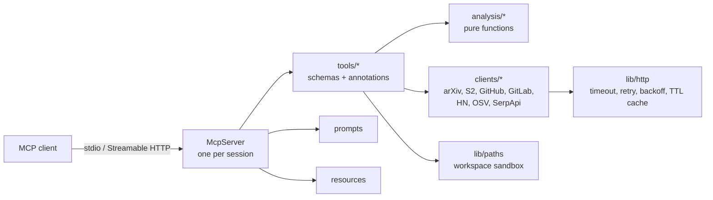

<div align="center">
  <h1>Ideation GOAT</h1>
  <p><strong>An MCP server for researching and de-risking software ideas</strong></p>
  <p>Papers · patents · open-source due diligence · local dependency security · project scaffolding</p>
</div>

---

Ideation GOAT is a [Model Context Protocol](https://modelcontextprotocol.io) server built on the official TypeScript SDK. It gives an AI assistant (Claude Desktop, Claude Code, Cursor, VS Code, or any MCP client) tools to answer the questions you ask before starting a project:

- *Has someone built this already, and is it maintained?* → `search_repositories`, `repo_health`, `repo_bug_patterns`
- *What does the research say, including in other fields?* → `search_papers`, `find_cross_domain_research`
- *Can I use it in my project?* → `repo_workspace_fit` (language + license), `repo_cloud_lockin`
- *Are my current dependencies safe?* → `scan_dependency_vulnerabilities` (OSV.dev, exact versions, CVSS scoring)
- *Turn the idea into a starting point* → `breed_concepts` prompt → `scaffold_project`

Everything works **without API keys**. Keys only raise rate limits or turn on optional sources.

## Quick start

```bash
git clone https://github.com/AdityaTummuri/Ideation_GOAT.git
cd Ideation_GOAT
npm ci && npm run build
npm run inspector        # opens the MCP Inspector against the stdio server
```

### Connect a client

**Claude Desktop / Cursor** (`claude_desktop_config.json` / `~/.cursor/mcp.json`):

```json
{
  "mcpServers": {
    "ideation-goat": {
      "command": "node",
      "args": ["/absolute/path/to/Ideation_GOAT/dist/index.js"],
      "env": {
        "WORKSPACE_ROOT": "/absolute/path/to/your/projects",
        "GITHUB_TOKEN": "optional"
      }
    }
  }
}
```

**Claude Code**

```bash
claude mcp add ideation-goat -e WORKSPACE_ROOT="$PWD" -- node /absolute/path/to/Ideation_GOAT/dist/index.js
```

**VS Code** (`.vscode/mcp.json`):

```json
{ "servers": { "ideation-goat": { "type": "stdio", "command": "node", "args": ["/absolute/path/to/Ideation_GOAT/dist/index.js"] } } }
```

**Remote / HTTP** (Streamable HTTP transport, one isolated session per client):

```bash
node dist/index.js --http --port 3333          # http://127.0.0.1:3333/mcp, health at /healthz

# Non-loopback binds require a bearer token; clients send "Authorization: Bearer <token>"
docker build -t ideation-goat .
docker run -e MCP_AUTH_TOKEN="$(openssl rand -hex 32)" -v "$PWD:/workspace" -p 127.0.0.1:3333:3333 ideation-goat
```

Idle HTTP sessions are closed after 30 minutes. Unknown session IDs get `404`, so clients re-initialize as the spec requires.

## Tools

| Tool | What it does | Data source | Output |
|---|---|---|---|
| `search_papers` | Parallel paper search; per-source failures reported, not fatal | arXiv, Semantic Scholar (+ Unpaywall PDFs) | real data |
| `find_cross_domain_research` | Searches non-CS arXiv categories (biology, physics, complex systems, economics, maths, engineering) for the same mechanism | arXiv | real data |
| `search_patents` | Prior-art keyword search; returns an error, never invented patents, when unconfigured | Google Patents via SerpApi | real data |
| `hacker_news_trends` | Story counts (last 30 days vs. prior 11-month average) and top stories | HN Algolia API | real data |
| `search_repositories` | Repository search sorted by stars | GitHub, GitLab | real data |
| `repo_health` | 0-100 maintenance score with a per-factor breakdown (factors GitHub refuses to return are marked unknown, not zero); OSV advisories at HEAD | GitHub, OSV.dev | transparent score |
| `repo_bug_patterns` | Groups recent bug-issue titles into recurring themes | GitHub issues | keyword clustering |
| `repo_cloud_lockin` | Flags direct dependencies on proprietary cloud SDKs, grades A-D | GitHub manifests | rule-based |
| `workspace_profile` | Languages, frameworks, build tools, license, layout pattern, dependencies | local files | real data |
| `repo_workspace_fit` | Language match, license compatibility, integration advice | local files + GitHub | rule-based |
| `scan_dependency_vulnerabilities` | Lockfile-aware OSV scan with CVSS v3 scoring, fixed versions, CI-style gate | local files + OSV.dev | real data |
| `dependency_injection_report` | Constructor-injection vs. inline construction per class | local files | **heuristic** |
| `estimate_edge_footprint` | Could this repo fit a microcontroller's RAM/flash? | GitHub | **low confidence** |
| `estimate_hosting_cost` | Monthly cost for AWS / Vercel / Supabase / Neon with itemised assumptions | hardcoded price table | **estimate** |
| `scaffold_project` | Runnable Node/Python/Go/Rust starter + Docker + your blueprint | writes local files | - |
| `evaluate_idea` | One-call overview: existing projects + health, papers, HN interest (with progress notifications) | all of the above | real data |

All tools declare an `outputSchema` and return `structuredContent`. Annotations mark which tools are read-only or reach the internet. `scaffold_project` is the only tool that writes.

**Prompts:** `breed_concepts` (hybridize two ideas into a testable design), `code_to_theory` (find the formal model behind code), `cross_domain_brainstorm` (guided workflow across the tools).

**Resources:** `ideation-goat://session/last-search` (latest results in this session), `ideation-goat://status` (which integrations are configured; values never shown).

## Configuration

| Variable | Effect |
|---|---|
| `WORKSPACE_ROOT` | The only directory local tools may read or write. Defaults to the process working directory (`/workspace` in Docker). |
| `MCP_AUTH_TOKEN` | Bearer token for the HTTP transport. Required when binding to a non-loopback address. |
| `GITHUB_TOKEN` | 60 → 5,000 GitHub requests/hour (search: 10 → 30/min). No scopes needed. |
| `SERPAPI_API_KEY` | Enables `search_patents`. |
| `SEMANTIC_SCHOLAR_API_KEY` | Dedicated Semantic Scholar rate limit. |
| `UNPAYWALL_EMAIL` | Enables open-access PDF lookup. |
| `GITLAB_TOKEN`, `GITLAB_API_BASE_URL` | Authenticated or self-hosted GitLab. |
| `LOG_LEVEL`, `HTTP_TIMEOUT_MS` | Logging (stderr only) and upstream timeout. |

## Architecture



- **`src/analysis`** holds pure, unit-tested logic (health scoring, CVSS v3 calculator, manifest/lockfile parsers, license rules, clustering, cost model).
- **`src/clients`** are thin typed API wrappers. All network goes through `lib/http` (timeouts, retry on 429/5xx with `Retry-After`, response cache, credential redaction in errors).
- **`lib/paths`** confines file access with `realpath` + `path.relative`. Sibling-prefix paths (`/root-evil` vs `/root`), symlinked or dangling-symlink directories, symlinked manifests, and scaffold writes through symlinks (`O_NOFOLLOW`) are all rejected.
- Logs go to **stderr only**, because stdout is the JSON-RPC channel in stdio mode.

## Development

```bash
npm run typecheck   # tsc, strict + noUncheckedIndexedAccess
npm test            # vitest: unit + in-memory MCP client + stdio binary + HTTP transport
npm run build
```

Tests mock `fetch`, so CI never calls external APIs. The integration suite connects a real MCP `Client` to the server over in-memory, stdio, and HTTP transports and validates every result against its output schema.

## Limitations

- Health scores, lock-in grades, and fit verdicts are transparent rules, not ground truth. Read the breakdowns.
- `estimate_hosting_cost` uses list prices hardcoded in `src/analysis/cost.ts`; they go out of date. Verify on provider pricing pages.
- `estimate_edge_footprint` compiles nothing. Only a real build tells you the binary size.
- `scan_dependency_vulnerabilities` skips dependencies without an exact version (reported under `unpinned`). Commit a lockfile for full coverage.
- License verdicts are coarse flags, not legal advice. The same applies to patent search results.

## License

GPL-3.0. See [LICENSE](LICENSE).
